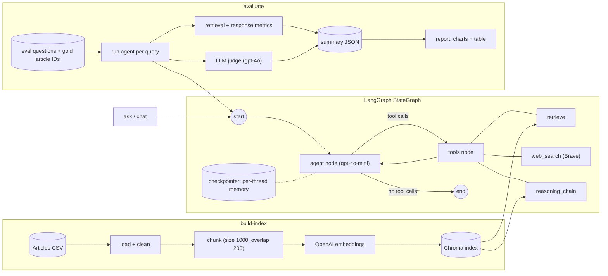
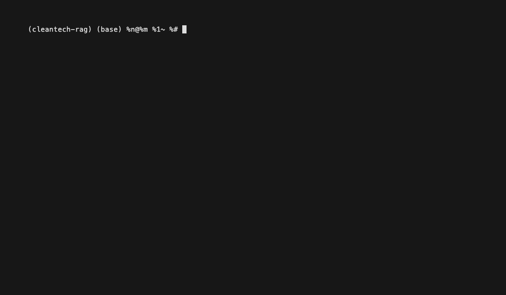
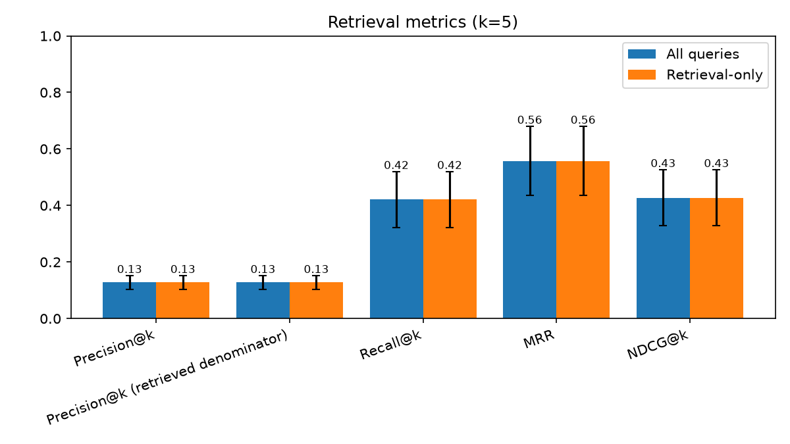
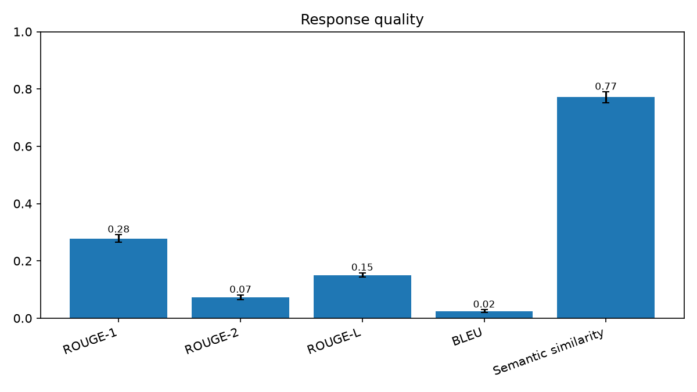
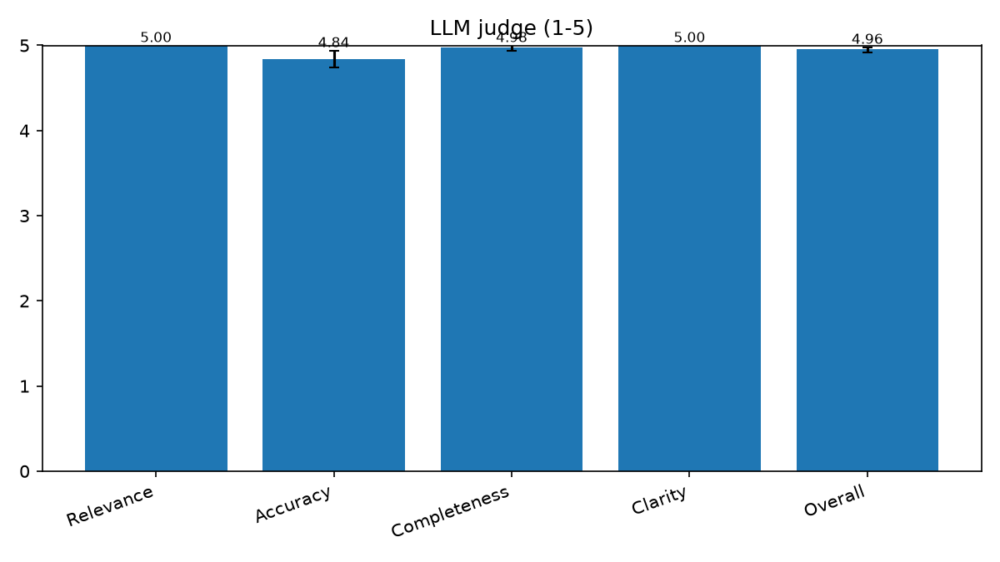

# CleanTech Agentic RAG

[](https://github.com/JoeGiwa/cleantech-rag/actions/workflows/ci.yml)

An agentic RAG system that answers questions about clean technology over ~20k CleanTech news
articles. A LangGraph agent decides per question whether to search the article index, search the
web (Brave), or run a step-by-step reasoning chain over retrieved articles, and it remembers the
conversation across turns. The repo also contains an evaluation suite (Precision/Recall/MRR/NDCG@k,
ROUGE/BLEU, semantic similarity, LLM-as-judge).

This is a cleaned-up, tested package version of an original Colab notebook
(`notebooks/agentic_rag_system.ipynb`, kept for reference only).

## Architecture



- The agent is a hand-written `agent <-> tools` loop (`src/cleantech_rag/agent.py`). Conversation
  history is stored per `thread_id` by a LangGraph checkpointer and trimmed to the last
  `MAX_HISTORY` turns, so memory updates every turn.
- `retrieved_ids` is reset for every run and filled only from that run's own tool results, so
  retrieval metrics cannot use another query's IDs.
- Documents are chunked before embedding; retrieval fetches several chunks per wanted article and
  returns up to `TOP_K` distinct articles.

## Setup

Requires Python 3.11+ and [uv](https://docs.astral.sh/uv/).

```bash
uv sync                  # runtime + dev dependencies
uv sync --extra eval     # also install what `evaluate` and `report` need
cp .env.example .env     # then fill in your keys
```

Secrets go in `.env` only (never committed): `OPENAI_API_KEY` (required) and `BRAVE_API_KEY`
(optional; without it web search is unavailable and the CLI warns).

Data files are not in git. Put them in `data/raw/`:

- `cleantech_media_dataset_v3_2024-10-28.csv` (the articles)
- `cleantech_rag_evaluation_data_2024-09-20.csv` (23 simple questions)
- `CleanTech-50answers.txt` (50 complex questions with reference answers and article IDs)

### Configuration

Settings are read from environment variables (or `.env`) with no prefix. Defaults:

| Variable | Default |
|---|---|
| `AGENT_MODEL` | `gpt-4o-mini` |
| `JUDGE_MODEL` | `gpt-4o` |
| `EMBEDDING_MODEL` | `text-embedding-3-small` |
| `TEMPERATURE` | `0.0` |
| `AGENT_RECURSION_LIMIT` | `12` (max graph steps per question) |
| `MAX_HISTORY` | `10` (previous turns kept per thread) |
| `CHUNK_SIZE` / `CHUNK_OVERLAP` | `1000` / `200` |
| `TOP_K` | `5` |
| `RETRIEVAL_OVERFETCH` | `4` (chunks fetched per wanted article) |
| `RAW_DATA_DIR` | `data/raw` |
| `CHROMA_DIR` | `data/chroma` |
| `COLLECTION_NAME` | `cleantech_articles` |

## Usage

Build a small development index first (a sample of articles plus every eval gold article):

```bash
uv run cleantech-rag build-index --limit 200
```

Then ask questions:

```bash
uv run cleantech-rag ask "What are the main challenges for grid-scale battery storage?"
uv run cleantech-rag chat          # interactive, remembers earlier turns; type 'exit' to quit
```

<!-- Demo GIF placeholder: once demo/chat.gif exists, uncomment the next line.

-->
To re-record the demo (costs a few API calls): `vhs demo/chat.tape` (needs the vhs CLI installed and a built index).

`ask` is single-shot with no memory; both commands print the answer followed by a numbered list of
the retrieved source articles (or `Sources: no articles retrieved this turn.` when none were).

Evaluate (needs `uv sync --extra eval`; calls paid APIs, see costs below):

```bash
uv run cleantech-rag evaluate --max-queries 3
uv run cleantech-rag evaluate --max-queries 3 --no-judge        # skip gpt-4o judging
uv run cleantech-rag evaluate --dataset simple --max-queries 3
uv run cleantech-rag evaluate --resume results/run_<timestamp>.jsonl
uv run cleantech-rag report results/summary_<timestamp>.json    # offline, free
```

All commands:

| Command | Flags |
|---|---|
| `ask QUESTION` | `--verbose` |
| `chat` | `--verbose` |
| `build-index` | `--limit N`, `--yes-full-corpus`, `--verbose` |
| `evaluate` | `--dataset {complex,simple}`, `--max-queries N`, `--no-judge`, `--judge-model MODEL`, `--yes-full-eval`, `--output-dir DIR`, `--resume RUN.jsonl`, `--verbose` |
| `report SUMMARY_JSON` | `--output-dir DIR`, `--verbose` |

`--verbose` can go before or after the command and shows HTTP and model-download logs, which are
hidden by default.

`evaluate` writes, to `--output-dir` (default `results/`): an incremental run log
(`run_<timestamp>.jsonl`, so a crash or Ctrl-C loses nothing already paid for; continue with
`--resume`), `summary_<timestamp>.json` and `per_query_<timestamp>.csv`. The `.jsonl` run logs and
per-query CSVs (they contain dataset text) are gitignored; summaries, tables and charts may be
committed.

**Resuming.** `evaluate --resume RUN.jsonl` takes its settings from the log's header: the dataset,
whether the judge ran, the judge model and the query limit (`--max-queries N`, or the full run). So
resuming a full run needs no `--yes-full-eval`, and the limit does not fall back to the default of 3.
`--max-queries` may be passed explicitly to override the logged limit (for example to extend a run).
`--dataset`, `--no-judge` and `--judge-model` cannot change the run: passing a value that conflicts
with the log is refused with an error. A log from an older version that did not record its query
limit is refused unless you pass `--max-queries` or `--yes-full-eval`.

`report` reads a summary JSON and writes a markdown table plus PNG charts (retrieval, response
quality and, if the judge ran, judge scores) next to it, or into `--output-dir`. The same
functions live in `src/cleantech_rag/evaluation/report.py`.

### Costs

These calls cost real money. The CLI has guards, and you should keep dev runs small.

| Action | What is spent | Guard |
|---|---|---|
| `build-index --limit 200` | OpenAI embeddings (`text-embedding-3-small`, $0.02 per 1M tokens) for a few hundred articles | none needed; small |
| `build-index` (full corpus) | Embeddings for all ~20k articles; the command prints a token and cost estimate first | refuses unless `--yes-full-corpus` |
| `ask` / `chat` | A few `gpt-4o-mini` calls per question, plus embeddings for the query; Brave API quota if web search is used | none |
| `evaluate` | Agent calls per query, plus one `gpt-4o` judge call per query unless `--no-judge` | defaults to 3 queries; more than 10 needs `--yes-full-eval`, which alone runs every query |
| `report` | Nothing (offline) | none |

## Results

### Baseline: original notebook (50 complex questions)

| Metric | Notebook baseline |
|---|---|
| Precision@5 | 0.092 |
| Recall@5 | 0.310 |
| MRR | 0.357 |
| NDCG@5 | 0.290 |
| ROUGE-1 | 0.278 |
| Semantic similarity | 0.676 |
| LLM-judge overall | 4.12 / 5 |

The retrieval numbers (precision, recall, MRR, NDCG) are **suspect** because of one bug: the
notebook let retrieved IDs leak from one query into the next when the agent used web search or the
reasoning tool (bug 2). Bug 5 (repeated article IDs for several queries) does not affect them: it
was a property of the dataset, not a parser bug (see below).

### Notes on interpreting retrieval metrics

- **Bug 5 investigation:** the answer-file parser is correct. The 50-answer file groups multiple
  questions under one article set: there are 35 distinct article sets and 26 queries share one.
  No gold ID is missing from the corpus.
- **Precision has a low ceiling.** Most questions have about 2 gold articles, so with k=5 the
  maximum achievable Precision@5 is about 0.4, not 1.0. Judge precision against that ceiling, and
  lean on Recall, MRR and NDCG.
- **Dev-sample numbers are inflated and not reported.** `build-index --limit N` always adds every
  gold article to the sample, so a small index is much easier than the real corpus. Only
  full-corpus numbers are reported below.

### This version (full corpus, 50 complex questions)

One run on 2026-10-28: full corpus index, all 50 complex questions, `gpt-4o-mini` agent,
`text-embedding-3-small` embeddings, `gpt-4o` judge, k=5. All 50 queries finished without errors,
all 50 used retrieval, and the judge scored all 50. Source:
[`results/summary_20261028T192319.json`](results/summary_20261028T192319.json) (table:
[`.md`](results/summary_20261028T192319.md)).

| Metric | Notebook baseline (suspect) | This version: mean [95% CI] |
|---|---|---|
| Precision@5 (divide by k, headline) | 0.092 | 0.128 [0.104, 0.152] |
| Precision@5 (retrieved denominator) | not measured | 0.128 [0.104, 0.152] |
| Recall@5 | 0.310 | 0.422 [0.322, 0.520] |
| MRR | 0.357 | 0.557 [0.437, 0.680] |
| NDCG@5 | 0.290 | 0.427 [0.328, 0.527] |
| ROUGE-1 | 0.278 | 0.278 [0.266, 0.291] |
| ROUGE-2 | not reported | 0.073 [0.065, 0.081] |
| ROUGE-L | not reported | 0.150 [0.143, 0.158] |
| BLEU | 0.0 for every query (bug) | 0.024 [0.020, 0.029] |
| Semantic similarity | 0.676 | 0.771 [0.752, 0.789] |
| LLM-judge overall (1-5) | 4.12 | 4.96 [4.92, 4.98] |

Measured cost: the full-corpus index (142,673 chunks), the 50-question eval with the gpt-4o judge,
and all development runs together came to $0.76 in total (OpenAI usage dashboard, Oct 28-29 2026).

Intervals are 95% percentile bootstrap CIs over the 50 questions (1000 resamples, seed 0).

Judge criteria for this run: relevance 5.00 [5.00, 5.00], accuracy 4.84 [4.74, 4.94],
completeness 4.98 [4.94, 5.00], clarity 5.00 [5.00, 5.00].





#### Caveats

- **The baseline is suspect.** Its retrieval numbers were affected by bug 2 (retrieved IDs leaking
  from one query into the next), so the before/after retrieval change is not a clean comparison.
- **The gains can't be credited to any one change.** Chunking, the ID-leak fix, removing duplicate
  retrieval and the LangGraph agent all changed at once. Without an ablation, the effect of each
  one is unknown.
- **Precision@5 is capped at about 0.4.** Most questions have about 2 gold articles, so 0.128 should
  be read against that ceiling, not against 1.0.
- **The LLM judge is saturated.** An overall score of 4.96/5, with relevance and clarity at 5.00, means
  the judge barely tells answers apart, so it is not useful for comparing versions.
- **ROUGE and BLEU are weak signals here.** The answers are free-form, and n-gram overlap with one
  reference answer rewards matching wording rather than being correct.
- **Baseline vs. this run's 95% CI (rough check only).** Six of the seven notebook baseline values
  fall below this run's 95% CI: Precision@5 (0.092 < 0.104), Recall@5 (0.310 < 0.322), MRR
  (0.357 < 0.437), NDCG@5 (0.290 < 0.328), semantic similarity (0.676 < 0.752) and judge overall
  (4.12 < 4.92). ROUGE-1 (0.278) falls inside [0.266, 0.291], so it shows no detectable change. This
  is not a formal significance test: the baseline is a single suspect point estimate with no
  interval of its own, and the CIs only cover question-sampling noise in this one run, not
  run-to-run variation in the agent.
- **The CIs are wide because n=50.** For example, Recall@5 spans about ±0.10 and MRR about ±0.12,
  and Precision@5 and Recall@5 clear the baseline by only about 0.01. Treat small differences as
  noise.

#### Next steps

- An ablation separating chunking from the agent and tool changes, to see which one drives the
  retrieval gains.
- A stricter judge based on grounding: score each claim against the retrieved articles and the
  reference answer, not on a 1-5 overall impression.

### Fixes relative to the notebook and expected impact

These are expected effects, not measured ones.

1. **Frozen memory fixed.** History now lives in a LangGraph checkpointer per `thread_id` and is
   read on every turn, so follow-up questions in `chat` can use earlier turns.
2. **Retrieval IDs no longer leak across queries.** IDs are reset per run and come only from that
   run's tool results. Queries answered without retrieval score against an empty list. Expect
   retrieval metrics to change, probably downward for queries that did not retrieve.
3. **Chunking is applied.** Articles are split (1000 chars, 200 overlap) before embedding, so long
   articles are no longer truncated. Expect better recall on details deep inside long articles.
4. **No duplicate retrieval.** The notebook's `summarize_and_answer` tool, which re-ran retrieval,
   is gone; the agent retrieves and answers in one loop. Expect fewer LLM calls and less latency.
5. **Dataset check for repeated IDs** (bug 5): parser verified, see above.
6. **Metric fixes.** Precision@k keeps the notebook's divide-by-k definition as the headline; a
   variant that divides by the number of documents actually retrieved is reported alongside it. BLEU tokenization was fixed so BLEU is no longer 0.0 for every query.

## Design decisions

- **Summarizer tool dropped.** The notebook's `summarize_and_answer` tool re-ran retrieval and
  duplicated work, so it was removed from the agent's tools. The agent writes the answer from what
  it retrieved. There is no conversation-summary feature.
- **Both precision variants are reported.** The notebook already divided by k; that stays the
  headline Precision@k. Precision over the retrieved count is added next to it, because the two
  differ when fewer than k documents come back.
- **Gold articles are always in dev samples.** `build-index --limit N` adds every eval gold
  article to the sampled articles so small indexes can answer the eval questions at all. The cost
  is that dev-sample metrics are inflated and must not be reported as results.
- **Retrieval metrics have two views.** `all_queries` counts a query that did not use retrieval as
  zero; `retrieval_only` averages only queries that did. Errored queries are excluded from all
  averages and counted in `n_errors`.
- **Tests are offline.** OpenAI, Brave and embeddings are faked; no test touches the network.

## Development

```bash
uv run pytest -q
uv run ruff check . && uv run ruff format --check .
```

Deployment (Docker, Cloud Run) is not part of this repo yet.
